<p align="center">
  
</p>

<h1 align="center">Hey, I'm Arhan Arif 👋</h1>
<p align="center">
  <strong>15-year-old self-taught developer</strong> from Aligarh, India — building real
  products at <strong>AI/ML × Web Development</strong>.
</p>
<p align="center">
  <a href="https://instagram.com/theyluvarhann"></a>
  <a href="https://github.com/ArhanArif07"></a>
</p>

<p align="center"><em>Turning "isn't verified" into "here's what it could be."</em></p>

---

## 🚀 What I Build

| Project | What it does |
|---|---|
| **NumLeads** | AI lead-intelligence engine — finds real businesses with no verified website, verifies presence from live sources, and generates custom website demos via a real coding agent |
| **Beacon** | AI career-powered Guidance Platform for students struggling to find a perfect career path and roadmap for there career.|
| **EONIS & ELYSSA** | Personal deep RAG voice assistant |
| **VelioLabs** · **Indian Coffee Brewry** | Web development projects |

I care about **honest systems** — NumLeads will never fabricate a business, a phone number or
a statistic. If the data doesn't exist, it says so.

---

## 🧠 About Me

```yaml
name: Arhan Arif
nickname: Arhan
age: 15
location: Aligarh, Uttar Pradesh, India
role: Self-Taught Developer
experience: 2 years
projects_completed: 8+

currently_building: ELYSSA
currently_learning: [AI Agents, LLM Tool Use, Retrieval, System Design]

interests:
  - Coding
  - AI / ML
  - Web Development
  - Building products people actually use

tools_i_reach_for_first:
  - TypeScript
  - Python
  - React
  - FastAPI
  - SQLite
  - AI

philosophy: Ship it, then make it honest.
```

---

## 🧰 Tools & Tech

<p align="center">
  
</p>
<p align="center">
  
</p>
<p align="center">
  
</p>

<details>
<summary>More I work with</summary>

<p align="center">
  
</p>
<p align="center">
  
</p>
<p align="center">
  
</p>

</details>


---

## 📈 GitHub Stats

<p align="center">
  
  
</p>


---

## 💬 Let's Connect

<p align="center">
  <a href="https://github.com/ArhanArif07?tab=repositories"></a>
  <a href="https://instagram.com/theyluvarhann"></a>
</p>

<p align="center">
  
</p>
